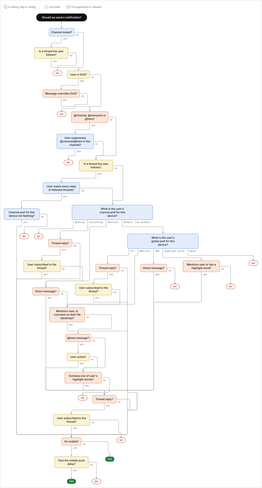

# Vantle

Vantle is an experiment in checking what coding agents build. It has two parts so far. The first turns the decision logic inside a TypeScript function into a flowchart and checks that chart against the real code. The second, called a receipt, checks an agent's "done" against examples that a person agreed to before the work started.

> **Status: pre-MVP, and rough.** This is a solo project, built in public. Nothing here is stable, there is no release, and the commands and file formats will change without notice. The chart extractor works on small, plain functions, but it still draws some charts wrong and many too big. Chart work is paused while the receipt is tested, apart from one change to how charts are drawn. The receipt has no code yet, and so far it has only been run by hand. The first test of it missed every bug it was aimed at. The details are in [ROADMAP.md](./ROADMAP.md) and in the post [Making Vantle, part 1](https://raymondyang.dev/writing/done-is-doing-a-lot-of-work).

## Charts from code

You mark a function with a comment that says which question it answers.

```ts
// @vantle: "Should we send a notification?"
export function shouldNotify(msg: Message, user: User, channel: Channel, device: Device): boolean {
```

Vantle then builds a chart of the function's checks and outcomes with static analysis, following calls into helper functions in the same repo. No AI is involved in building the chart. Claude can then relabel the boxes in product language, and Vantle checks that the labeled chart still behaves exactly like the code. Last, `vantle verify` has Claude write tests for a set of paths that together cover every arrow in the chart (or for every path, with `--all-paths`), and runs those tests against the real code, instrumented so that Vantle can see which route the code actually took.

"Verified" means that a test drove the real code through exactly that route to that outcome. It is evidence for those inputs, not a proof that the chart matches the code for every input. Anything Vantle can't check is reported as unverified or listed, never counted as verified.

[`fixtures/slack-notify`](./fixtures/slack-notify) is a TypeScript version of Slack's published notification flowchart, written for this project. This is the chart Vantle builds from it. Vantle draws each chart as an SVG, with right-angle arrows and a separate end for each arrow into an outcome, as in Slack's own chart. It also writes the same chart in Mermaid.



On real code, GrowthBook's `runExperiment` (415 lines), which decides whether a user is in an A/B test and which variation they get, comes out as 27 boxes. Every arrow but one is verified against the real code. The details are in [docs/m4-growthbook.md](./docs/m4-growthbook.md).

On 60 functions from 20 open-source TypeScript repos, 16 charts were usable at first, against a target of 50%. After two rounds of fixes, 23 were usable if arrows that no run can take count as noise, and 10 if they count as wrong. The write-ups are in [docs/experiments/](./docs/experiments/).

## Receipts

Before an agent changes behaviour, it proposes a few example rows, each saying "given this situation, expect this outcome" or saying what must stay the same. A person approves them. After the agent says done, something other than that agent runs every row and writes down the evidence, any edited or skipped tests, and any files changed outside the agreed scope.

There is no receipt code yet. The row format, the agent skill used to run receipts by hand, and what the trials found are in [docs/receipts/](./docs/receipts/).

## Try it

You need Node 22.12 or later.

```sh
npm install
npm run build

# Which functions hold the most decision logic?
node dist/cli.js -p fixtures/slack-notify scan

# Chart the marked function. This writes .vantle/flows/should-notify.{raw.json,svg,mmd,md},
# plus should-notify.json when labels run.
# Labels need Anthropic credentials (ANTHROPIC_API_KEY or `ant auth login`).
# Without them, or with --no-label, the chart shows raw code.
node dist/cli.js -p fixtures/slack-notify generate

# See exactly what would be sent to Claude, without sending it
node dist/cli.js -p fixtures/slack-notify label --dry-run

# Check the chart against the real code: one test per path, covering every arrow,
# plus a check that the tests ran all the charted code, so missing branches show up.
# Saved tests are reused, so re-running is free and catches code that changed.
node dist/cli.js -p fixtures/slack-notify verify

# Check the chart against the hand-written reference, input by input
# (add --labels to also grade the labels with an LLM judge)
node dist/cli.js -p fixtures/slack-notify score fixtures/slack-notify/expected.json
```

In your own TypeScript project, mark a function and run `vantle generate` from the folder that holds `tsconfig.json`. The `label` and `verify` steps send your function's code to Anthropic's API and cost money. `extract`, `scan` and `generate --no-label` run locally.

## What to read

- [SPEC.md](./SPEC.md) describes what the chart tool does and how.
- [VISION.md](./VISION.md) is the original vision for charts. It predates the receipt, and [ROADMAP.md](./ROADMAP.md) is more current.
- [docs/design/](./docs/design/) holds the design notes for the extractor's core and the correctness check.
- [docs/reviews/round-1.md](./docs/reviews/round-1.md) lists the bugs that the first code review found.
- [docs/experiments/](./docs/experiments/) holds the measurements on public repos, with the data and scripts to recompute them.
- [docs/decisions.md](./docs/decisions.md) lists the decisions that are settled, and links to why each was made. [CLAUDE.md](./CLAUDE.md) describes how the work is done, mostly by coding agents, with a person approving plans and merging.

## Development

```sh
npm test           # vitest; the full suite takes about two minutes
npm run typecheck
npm run dev -- -p fixtures/slack-notify generate   # run from source
npx tsx experiments/correctness.ts                 # run charted functions on many inputs and compare each run with its chart
```

This repository starts from a snapshot of a private one, so its history begins at the snapshot. Older documents mention pull request numbers and commits from that private history, which aren't available here. The CI workflows that call Claude aren't included yet, because they're tied to the author's Anthropic account. The scripts they used are still in `scripts/`.

## Contributing

Issues are welcome, especially a function that Vantle charts wrong, with the smallest code that shows it. Pull requests may sit for a while, because the direction is still changing quickly.

## License

[Apache License 2.0](./LICENSE).
